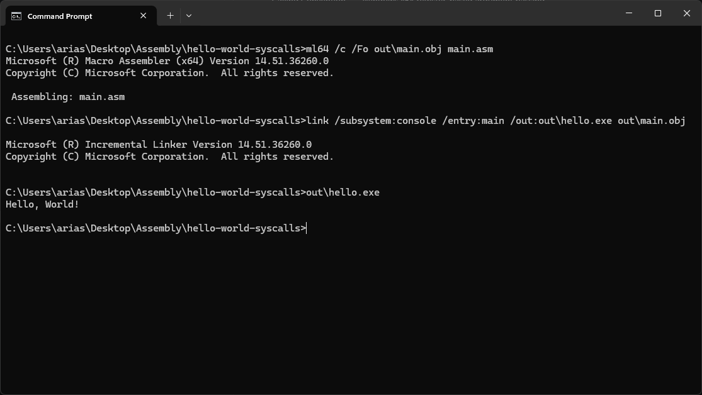

# Hello World — Windows x64 Assembly

<p align="center">
  <strong>A minimal Hello World program written in x64 MASM assembly for Windows.</strong>
  <br />
  Demonstrating direct Windows system calls using the x64 syscall instruction.
</p>

<p align="center">
  
  
  
  
</p>

---

## Overview

This project demonstrates a basic Windows console application written entirely in x64 assembly language.

Instead of relying on a C or C++ runtime, the program combines Windows API functions with a direct Windows system call to:

- Retrieve the standard output handle.
- Execute a direct system call using the x64 `syscall` instruction.
- Write text through the Windows Native API system service.
- Terminate the process.

The system call is implemented in a custom MASM procedure, `SysNtWriteFile`, which executes the `syscall` instruction directly instead of calling the NTDLL `NtWriteFile` wrapper.

This project serves as a hands-on introduction to Windows x64 assembly, MASM syntax, the Windows x64 calling convention, syscall argument handling, and low-level operating system interaction.

## Screenshot

<p align="center">
  
  <br />
  <em>Output Screenshot 1.</em>
</p>

## Output

```text
Hello, World!
```

## Project Structure

```text
hello-world-syscalls/
│
├── main.asm
├── README.md
│
├── img/
│   └── screenshot.bmp
│
├── out/
│   ├── main.obj
│   └── hello.exe
│
└── .gitignore
```

## Requirements

| Component | Requirement |
|---|---|
| Operating System | Windows 10 / Windows 11 |
| Architecture | x64 |
| Assembler | Microsoft MASM (`ml64.exe`) |
| Linker | Microsoft Linker (`link.exe`) |
| Toolchain | Visual Studio or Visual Studio Build Tools |
| SDK | Windows SDK |

## Getting Started

### 1. Install the required tools

Install Visual Studio Community or Visual Studio Build Tools.

In the Visual Studio Installer, make sure the following components are available:

- MSVC C++ x64/x86 build tools
- Windows 10 or Windows 11 SDK

The exact installation paths and versions may differ depending on your Visual Studio edition and installation configuration.

### 2. Configure the MASM environment

Open a Visual Studio Developer Command Prompt or Developer PowerShell.

Alternatively, configure the environment manually by locating your installed:

- MSVC `bin\Hostx64\x64` directory.
- MSVC `include` directory.
- MSVC `lib\x64` directory.
- Windows SDK `um\x64` and `ucrt\x64` library directories.

Ensure the assembler and linker are available through `PATH`, and the required libraries are available through `LIB`.

Verify the installation:

```cmd
where ml64
where link
```

Both commands should resolve to their respective executables.

### 3. Assemble

Open Command Prompt in the project directory:

```cmd
mkdir out
ml64 /c /Fo out\main.obj main.asm
```

### 4. Link

```cmd
link /SUBSYSTEM:CONSOLE /ENTRY:main /OUT:out\hello.exe out\main.obj kernel32.lib
```

### 5. Run

```cmd
out\hello.exe
```

## Concepts Demonstrated

| Concept | Description |
|---|---|
| MASM | Microsoft x64 assembly syntax |
| Direct System Calls | Executing the CPU's `syscall` instruction |
| Windows Native API | Invoking the `NtWriteFile` kernel service directly |
| Registers | Using RCX, RDX, R8, R9, R10, and RAX |
| Syscall Convention | Preparing arguments for the Windows x64 syscall interface |
| Stack Management | Reserving stack space and handling syscall arguments |
| Calling Convention | Windows x64 register-based argument passing |
| Linking | Resolving external Windows API functions |
| Process Termination | Using `ExitProcess` |

## System Call Implementation

The program implements its own `SysNtWriteFile` procedure:

```asm
SysNtWriteFile PROC
    mov r10, rcx
    mov eax, 08h
    syscall
    ret
SysNtWriteFile ENDP
```

The instructions perform the following operations:

| Instruction | Purpose |
|---|---|
| `mov r10, rcx` | Preserves the first argument in the register expected by the Windows syscall interface |
| `mov eax, 08h` | Loads the `NtWriteFile` system service number |
| `syscall` | Executes the CPU's system-call instruction |
| `ret` | Returns to the caller with the syscall result in RAX |

The syscall number `08h` is based on the Windows x64 syscall tables referenced by [j00ru's Windows System Call Tables](https://j00ru.vexillium.org/syscalls/nt/64/).

System service numbers are implementation details and should be verified against the Windows versions and builds being targeted.

## Windows API Functions

The program also uses two functions from `Kernel32.dll`.

| Function | Purpose |
|---|---|
| `GetStdHandle` | Retrieves the standard output handle |
| `ExitProcess` | Terminates the current process |

Unlike `SysNtWriteFile`, these functions are ordinary Windows API calls.

## Important Note

This implementation executes a **direct Windows system call** using the CPU's `syscall` instruction.

It does not call the NTDLL `NtWriteFile` wrapper to perform the write operation.

The program still uses Win32 API functions for standard output handle retrieval and process termination. Only the write operation is performed through the custom direct syscall wrapper.

The syscall number and behavior should be validated on each supported Windows build before assuming compatibility.

## License

This project is available under the [MIT License](LICENSE).

---

<p align="center">
  <strong>Learning Windows x64 Assembly, one instruction at a time.</strong>
  <br />
  Made with MASM on Windows.
</p>